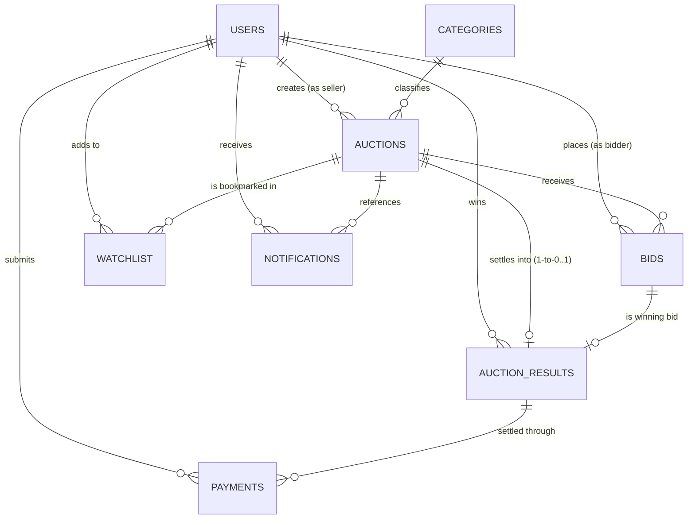

# BIDSPHERE: AN ENTERPRISE ONLINE AUCTION MANAGEMENT SYSTEM
### A Database Management System Project Report

---

**Course Code:** [COURSE_CODE_PLACEHOLDER]  
**Course Name:** Database Management Systems Laboratory  
**Department:** Department of Computer Science & Engineering  
**Institution:** [INSTITUTION_NAME_PLACEHOLDER]  
**Academic Year:** 2025–2026  

**Submitted by:**  
- **Student Name:** [STUDENT_NAME_PLACEHOLDER]  
- **Enrollment Number:** [ENROLLMENT_NO_PLACEHOLDER]  
- **Semester / Batch:** B.Tech CSE — VI Semester, Section [SECTION_PLACEHOLDER]  

**Supervised by:**  
- **Faculty Guide:** [FACULTY_GUIDE_NAME_PLACEHOLDER]  
- **Designation:** [FACULTY_DESIGNATION_PLACEHOLDER]  

---

## TABLE OF CONTENTS

1. [CHAPTER 1: Introduction and Problem Statement](#chapter-1-introduction-and-problem-statement)
2. [CHAPTER 2: System Architecture and Workflow](#chapter-2-system-architecture-and-workflow)
3. [CHAPTER 3: Database Design & Schema Specification](#chapter-3-database-design--schema-specification)
4. [CHAPTER 4: Normalization Theory & Verification](#chapter-4-normalization-theory--verification)
5. [CHAPTER 5: SQL Demonstration Queries & Analytical Output](#chapter-5-sql-demonstration-queries--analytical-output)
6. [CHAPTER 6: Connecting the Frontend to the Database (Architecture & Security)](#chapter-6-connecting-the-frontend-to-the-database)
7. [CHAPTER 7: Streamlit Frontend Implementation & Visual Verification](#chapter-7-streamlit-frontend-implementation--visual-verification)
8. [CHAPTER 8: Automated Testing, Concurrency & Verification](#chapter-8-automated-testing-concurrency--verification)
9. [CHAPTER 9: Conclusion, Limitations and Future Scope](#chapter-9-conclusion-limitations-and-future-scope)
10. [APPENDIX: Reverse Engineering Physical EER Diagram in MySQL Workbench](#appendix-reverse-engineering-physical-eer-diagram-in-mysql-workbench)

---

## CHAPTER 1: Introduction and Problem Statement

### 1.1 Background & Motivation
In traditional physical auction houses and unverified classifieds platforms, participants face significant barriers including geographical constraints, lack of price transparency, timing synchronization issues, and fraud risks. With the expansion of digital commerce, online auction management systems have become essential for establishing fair market value through real-time competitive bidding.

However, developing a reliable online auction system poses profound database engineering challenges:
1. **Concurrent Bidding Anomalies:** When multiple bidders attempt to place bids simultaneously in the final seconds of an auction ("bid sniping"), race conditions can result in lost updates, inconsistent prices, or duplicate winning declarations.
2. **Referential & State Integrity:** Incomplete settlements, orphan records, and unauthorized bid withdrawals can corrupt system balance.
3. **Auditability & Traceability:** High-value transactions demand immutable audit logging for regulatory compliance and dispute resolution.

### 1.2 Problem Statement
To design, implement, and verify a robust, full-stack, database-driven **Online Auction Management System named BidSphere**, engineered using **MySQL 8.0+**, **FastAPI**, and **Streamlit**. The system must enforce ACID transactional integrity, pessimistic row-level concurrency control (`SELECT ... FOR UPDATE`), server-side role-based authorization, automated audit logging, idempotent settlement procedures, and an intuitive user interface.

### 1.3 Key Objectives
- **Relational Integrity:** Establish a normalized schema across nine core tables adhering to 3NF standards with foreign keys and check constraints.
- **Pessimistic Concurrency Control:** Implement stored procedures (`PlaceBid`, `CloseAuction`) using database row locks to guarantee zero race conditions during simultaneous bids.
- **Strict Decoupling (3-Tier):** Ensure the Streamlit frontend communicates exclusively via HTTP REST endpoints to FastAPI, never directly executing SQL.
- **Live Auditing:** Deploy database triggers to capture state changes in JSON format inside an audit trail table.
- **Comprehensive Verification:** Execute an automated pytest suite validating registration, RBAC, bidding rules, concurrency, and constraint enforcement.

---

## CHAPTER 2: System Architecture and Workflow

### 2.1 Three-Layer Architectural Design
BidSphere adopts an industry-standard **Three-Tier Architecture** that enforces separation of concerns:

```
+-----------------------------------------------------------------------+
|                       PRESENTATION TIER (PORT 8501)                   |
|   Streamlit Multi-View UI • Plotly Charts • Pandas Tables • CSS Tokens |
+-----------------------------------------------------------------------+
                                   |
                HTTP REST / JSON Requests (Bearer JWT Token)
                                   v
+-----------------------------------------------------------------------+
|                    APPLICATION & LOGIC TIER (PORT 8000)                |
|  FastAPI • Uvicorn ASGI • Pydantic v2 Validation • Argon2 Password    |
|  Hashing • JWT Auth & RBAC Dependencies • Modular Domain Services      |
+-----------------------------------------------------------------------+
                                   |
           SQLAlchemy 2.0 ORM / Connection Pool / PyMySQL Driver
                                   v
+-----------------------------------------------------------------------+
|                      DATA PERSISTENCE TIER (PORT 3306)                |
|  MySQL 8.0+ Community Server (InnoDB Engine) • 9 Relational Tables    |
|  Pessimistic Row Locks (FOR UPDATE) • Stored Procedures • Triggers    |
+-----------------------------------------------------------------------+
```

### 2.2 System Workflows

#### A. User Registration & Authentication Workflow
1. User submits username, email, full legal name, password, role (`BUYER` or `SELLER`), and optional contact information.
2. FastAPI validates inputs using Pydantic regex and verifies uniqueness against `users` table.
3. Plaintext password is cryptographically hashed using **Argon2** (`$argon2id$v=19$...`).
4. On sign in, credentials are authenticated and a signed **HMAC-SHA256 (HS256) JWT access token** is issued.

#### B. Transactional Bidding Workflow (`PlaceBid`)
1. Client sends POST request with `auction_id` and `bid_amount`.
2. FastAPI extracts `bidder_id` from verified JWT claims.
3. Backend invokes MySQL stored procedure `PlaceBid(auction_id, bidder_id, bid_amount, ...)`.
4. Stored procedure starts a transaction and acquires an exclusive row lock:
   ```sql
   SELECT seller_id, current_price, status, start_time, end_time
   FROM auctions WHERE auction_id = p_auction_id FOR UPDATE;
   ```
5. Enforces critical business rules:
   - Bidder account must be active.
   - Auction status must be `ACTIVE`.
   - Current timestamp must fall within `[start_time, end_time]`.
   - Bidder must not be the auction's seller (`v_seller_id != p_bidder_id`).
   - Bid amount must exceed `current_price + bid_increment`.
6. Previous winning bid marked `OUTBID`; new bid inserted as `ACCEPTED`.
7. `auctions.current_price` updated to new bid amount.
8. Notifications dispatched to outbid user and new leading bidder.
9. Audit record written into `audit_logs`.
10. Procedure issues `COMMIT`.

#### C. Auction Settlement Workflow (`CloseAuction`)
1. Scheduled worker or authorized user triggers closure via `/api/v1/auctions/{id}/close`.
2. Idempotency check: if `auction_results` already contains a row for this auction, the existing record is returned without modifications.
3. Row lock acquired on auction.
4. Identifies winning bid via deterministic tie-breaking: `ORDER BY bid_amount DESC, bid_time ASC, bid_id ASC LIMIT 1`.
5. If bids exist: status set to `CLOSED`, winner recorded, `AUCTION_WON` notification sent.
6. If no bids exist: status set to `UNSOLD`, final price set to 0.00.

---

## CHAPTER 3: Database Design & Schema Specification

### 3.1 Entity-Relationship (ER) Overview
The database `bidsphere_db` comprises **nine relational tables**:



### 3.2 Schema Table Specifications

#### 1. `users` Table
Stores participant profiles, authentication credentials, and access roles.
- `user_id` (BIGINT, PK, AUTO_INCREMENT)
- `username` (VARCHAR(50), UNIQUE, NOT NULL)
- `email` (VARCHAR(100), UNIQUE, NOT NULL)
- `password_hash` (VARCHAR(255), NOT NULL) — Argon2 hash
- `full_name` (VARCHAR(100), NOT NULL)
- `role` (ENUM('BUYER', 'SELLER', 'ADMIN'), DEFAULT 'BUYER')
- `phone` (VARCHAR(20), NULL)
- `address` (TEXT, NULL)
- `is_active` (BOOLEAN, DEFAULT TRUE)
- `created_at` (TIMESTAMP, DEFAULT CURRENT_TIMESTAMP)
- `updated_at` (TIMESTAMP, ON UPDATE CURRENT_TIMESTAMP)
- **Constraint:** `chk_users_email_format CHECK (email LIKE '%_@__%.__%')`

#### 2. `categories` Table
Organizes auction lots into structured taxonomy.
- `category_id` (INT, PK, AUTO_INCREMENT)
- `name` (VARCHAR(50), UNIQUE, NOT NULL)
- `description` (VARCHAR(255), NULL)
- `icon` (VARCHAR(50), DEFAULT 'tag')
- `created_at` (TIMESTAMP, DEFAULT CURRENT_TIMESTAMP)

#### 3. `auctions` Table
Represents marketplace items listed for competitive bidding.
- `auction_id` (BIGINT, PK, AUTO_INCREMENT)
- `seller_id` (BIGINT, FK -> `users.user_id`, ON DELETE RESTRICT)
- `category_id` (INT, FK -> `categories.category_id`, ON DELETE RESTRICT)
- `title` (VARCHAR(150), NOT NULL)
- `description` (TEXT, NOT NULL)
- `starting_price` (DECIMAL(12,2), NOT NULL, CHECK > 0)
- `current_price` (DECIMAL(12,2), NOT NULL, CHECK >= starting_price)
- `bid_increment` (DECIMAL(10,2), DEFAULT 50.00, CHECK > 0)
- `status` (ENUM('SCHEDULED','ACTIVE','CLOSED','CANCELLED','UNSOLD'))
- `start_time` (DATETIME, NOT NULL)
- `end_time` (DATETIME, NOT NULL)
- `image_url` (VARCHAR(500), NULL)
- **Constraints:** `chk_auctions_time_window CHECK (end_time > start_time)`

#### 4. `bids` Table
Logs all monetary bid submissions.
- `bid_id` (BIGINT, PK, AUTO_INCREMENT)
- `auction_id` (BIGINT, FK -> `auctions.auction_id`, ON DELETE CASCADE)
- `bidder_id` (BIGINT, FK -> `users.user_id`, ON DELETE RESTRICT)
- `bid_amount` (DECIMAL(12,2), NOT NULL, CHECK > 0)
- `bid_time` (DATETIME, DEFAULT CURRENT_TIMESTAMP)
- `status` (ENUM('ACCEPTED','OUTBID','CANCELLED'))

#### 5. `watchlist` Table
Many-to-many relationship linking users to bookmarked auctions.
- `watchlist_id` (BIGINT, PK, AUTO_INCREMENT)
- `user_id` (BIGINT, FK -> `users.user_id`, ON DELETE CASCADE)
- `auction_id` (BIGINT, FK -> `auctions.auction_id`, ON DELETE CASCADE)
- **Constraint:** `uk_watchlist_user_auction UNIQUE (user_id, auction_id)`

#### 6. `auction_results` Table
Definitive settlement record for each concluded auction.
- `result_id` (BIGINT, PK, AUTO_INCREMENT)
- `auction_id` (BIGINT, FK -> `auctions.auction_id`, UNIQUE, NOT NULL)
- `winner_id` (BIGINT, FK -> `users.user_id`, NULL if UNSOLD)
- `winning_bid_id` (BIGINT, FK -> `bids.bid_id`, NULL if UNSOLD)
- `final_price` (DECIMAL(12,2), NOT NULL, DEFAULT 0.00)
- `closed_at` (DATETIME, DEFAULT CURRENT_TIMESTAMP)
- `result_status` (ENUM('WON','UNSOLD','CANCELLED'))

#### 7. `payments` Table
Simulated payment transactions for settled lots.
- `payment_id` (BIGINT, PK, AUTO_INCREMENT)
- `result_id` (BIGINT, FK -> `auction_results.result_id`, ON DELETE RESTRICT)
- `buyer_id` (BIGINT, FK -> `users.user_id`, ON DELETE RESTRICT)
- `amount` (DECIMAL(12,2), NOT NULL)
- `payment_method` (ENUM('SIMULATED_UPI','SIMULATED_NETBANKING','SIMULATED_CARD'))
- `status` (ENUM('PENDING','SUCCESS','FAILED'))
- `transaction_reference` (VARCHAR(100), UNIQUE, NOT NULL)
- `paid_at` (DATETIME, NULL)

#### 8. `notifications` Table
Real-time user alerts for bidding events and settlements.
- `notification_id` (BIGINT, PK, AUTO_INCREMENT)
- `user_id` (BIGINT, FK -> `users.user_id`, ON DELETE CASCADE)
- `auction_id` (BIGINT, FK -> `auctions.auction_id`, ON DELETE SET NULL)
- `title` (VARCHAR(150), NOT NULL)
- `message` (TEXT, NOT NULL)
- `is_read` (BOOLEAN, DEFAULT FALSE)
- `notification_type` (ENUM('BID_PLACED','OUTBID','AUCTION_WON','AUCTION_CLOSED','AUCTION_UNSOLD','PAYMENT_RECEIVED'))

#### 9. `audit_logs` Table
Immutable audit trail capturing database mutation events.
- `log_id` (BIGINT, PK, AUTO_INCREMENT)
- `table_name` (VARCHAR(50), NOT NULL)
- `operation` (ENUM('INSERT','UPDATE','DELETE'))
- `record_id` (BIGINT, NOT NULL)
- `changed_by` (VARCHAR(100), NULL)
- `old_values` (JSON, NULL)
- `new_values` (JSON, NULL)
- `action_timestamp` (TIMESTAMP, DEFAULT CURRENT_TIMESTAMP)

---

## CHAPTER 4: Normalization Theory & Verification

### 4.1 First Normal Form (1NF)
**Definition:** A relation is in 1NF if and only if all attribute domains contain atomic (indivisible) values and there are no repeating groups.
- In `bidsphere_db`, every attribute in every table stores a single atomic value.
- Multivalued concepts (such as multiple bids on an auction or multiple bookmarked lots per user) are factored out into independent relational tables (`bids`, `watchlist`) rather than stored as delimited lists or composite fields.
- Primary keys are explicitly defined on every table.

### 4.2 Second Normal Form (2NF)
**Definition:** A relation is in 2NF if it is in 1NF and every non-prime attribute is fully functionally dependent on the entire primary key (no partial dependencies).
- In tables with composite candidate keys, such as `watchlist(user_id, auction_id)`:
  - Synthetic surrogate key `watchlist_id` is chosen as the primary key.
  - The uniqueness constraint `UNIQUE(user_id, auction_id)` guarantees integrity.
  - Attribute `created_at` depends on the specific pairing `(user_id, auction_id)`, so no partial dependency exists.
- In all single-attribute primary key tables (`users`, `auctions`, `bids`, etc.), partial dependencies are mathematically impossible. Thus, the schema strictly satisfies 2NF.

### 4.3 Third Normal Form (3NF)
**Definition:** A relation is in 3NF if it is in 2NF and no non-prime attribute is transitively dependent on the primary key (no $X \to Y \to Z$ where $Z$ is non-prime).
- Consider `auctions`:
  - `auction_id -> category_id`
  - Rather than storing `category_name` and `category_description` inside `auctions` (which would introduce transitive dependency: `auction_id -> category_id -> category_name`), category data is isolated in the `categories` relation.
- Consider `auction_results`:
  - `result_id -> auction_id`
  - Winner details (`winner_email`, `winner_phone`) are not duplicated in `auction_results`; only `winner_id` is maintained as a foreign key referencing `users`.
- Therefore, no transitive dependencies exist on non-prime attributes, satisfying 3NF.

### 4.4 Boyce-Codd Normal Form (BCNF) Analysis
**Definition:** A relation is in BCNF if for every non-trivial functional dependency $X \to Y$, $X$ is a superkey.
- In `users`: candidate keys are `user_id`, `username`, and `email`. All functional dependencies originate from these candidate keys.
- In `auctions`: `auction_id` is the primary key and superkey.
- In `auction_results`: candidate keys are `result_id` and `auction_id` (since each auction produces at most one final result). Functional dependencies:
  - `result_id -> auction_id, winner_id, winning_bid_id, final_price, closed_at, result_status`
  - `auction_id -> result_id, winner_id, winning_bid_id, final_price, closed_at, result_status`
  Both determinants are candidate keys.
- Thus, the schema satisfies BCNF without exception.

---

## CHAPTER 5: SQL Demonstration Queries & Analytical Output

The system includes 16 tested SQL queries executing complex joins, aggregates, subqueries, CTEs, and window functions.

### Query 4: Identifying High-Competition Auctions (`GROUP BY` & `HAVING`)
```sql
SELECT 
    a.auction_id,
    a.title,
    a.current_price,
    COUNT(b.bid_id) AS accepted_bids_count
FROM auctions a
JOIN bids b ON a.auction_id = b.auction_id
WHERE b.status IN ('ACCEPTED', 'OUTBID')
GROUP BY a.auction_id, a.title, a.current_price
HAVING COUNT(b.bid_id) >= 3
ORDER BY accepted_bids_count DESC;
```
**Actual Obtained Output:**
| auction_id | title | current_price | accepted_bids_count |
|---|---|---|---|
| 1 | Apple MacBook Pro M3 Max 16-inch | 215000.00 | 5 |
| 2 | Sony PlayStation 5 Disc Edition | 42000.00 | 4 |
| 11 | Apple iPhone 15 Pro Max 256GB | 108000.00 | 4 |
| 3 | Authentic Tanjore Painting | 55000.00 | 3 |
| 4 | 1947 Republic of India Inaugural Stamp | 31000.00 | 3 |
| 5 | Omega Seamaster Diver 300M | 310000.00 | 3 |
| 7 | Contemporary Abstract Canvas "Monsoon Raga" | 72000.00 | 3 |

### Query 14: Window Function — Bid Ranking within Lots (`DENSE_RANK()`)
```sql
SELECT 
    b.auction_id,
    a.title,
    u.username AS bidder_name,
    b.bid_amount,
    DENSE_RANK() OVER (
        PARTITION BY b.auction_id 
        ORDER BY b.bid_amount DESC
    ) AS bid_rank
FROM bids b
JOIN auctions a ON b.auction_id = a.auction_id
JOIN users u ON b.bidder_id = u.user_id
WHERE b.status IN ('ACCEPTED', 'OUTBID')
ORDER BY b.auction_id, bid_rank ASC;
```
**Actual Obtained Output (Sample):**
| auction_id | title | bidder_name | bid_amount | bid_rank |
|---|---|---|---|---|
| 1 | Apple MacBook Pro M3 Max | karthik_m | 215000.00 | 1 |
| 1 | Apple MacBook Pro M3 Max | vikram_b | 210000.00 | 2 |
| 1 | Apple MacBook Pro M3 Max | amit_kumar | 200000.00 | 3 |
| 1 | Apple MacBook Pro M3 Max | sneha_rao | 195000.00 | 4 |
| 1 | Apple MacBook Pro M3 Max | vikram_b | 185000.00 | 5 |

### Query 15: Common Table Expression (CTE) — Top Spending Bidders
```sql
WITH BidderAggregates AS (
    SELECT 
        u.user_id,
        u.username,
        u.full_name,
        COUNT(r.result_id) AS won_count,
        COALESCE(SUM(r.final_price), 0.00) AS total_won_spend
    FROM users u
    JOIN auction_results r ON u.user_id = r.winner_id
    WHERE r.result_status = 'WON'
    GROUP BY u.user_id, u.username, u.full_name
)
SELECT username, full_name, won_count, total_won_spend
FROM BidderAggregates
ORDER BY total_won_spend DESC
LIMIT 3;
```
**Actual Obtained Output:**
| username | full_name | won_count | total_won_spend |
|---|---|---|---|
| rohit_sharma | Rohit Sharma | 1 | 520000.00 |
| vikram_b | Vikram Joshi | 1 | 108000.00 |
| ananya_sen | Ananya Sen | 1 | 24000.00 |

---

## CHAPTER 6: Connecting the Frontend to the Database

### 6.1 Strict Architectural Boundary
In compliance with project specifications, **Streamlit never connects directly to MySQL and never executes database queries directly**.

```
[Streamlit Frontend] 
       | (JSON over HTTP)
       v
[FastAPI Backend Router] 
       | (Pydantic Validation & Security)
       v
[Domain Service / Stored Procedure] 
       | (SQLAlchemy & PyMySQL Driver)
       v
[MySQL 8.0 InnoDB Database]
```

### 6.2 Connection Management & Connection Pooling
The backend utilizes SQLAlchemy with robust connection pooling:
- `pool_size = 10`: Maintains 10 warm connections in the pool.
- `max_overflow = 20`: Accommodates traffic bursts with up to 20 ephemeral connections.
- `pool_pre_ping = True`: Executes a lightweight ping (`SELECT 1`) to detect and discard stale or severed TCP sockets before assigning a connection to a request.
- `pool_recycle = 3600`: Recycles connections hourly to avoid MySQL idle disconnect timeouts (`wait_timeout`).

### 6.3 Security & Credential Isolation
- Credentials (`DB_USER`, `DB_PASSWORD`, `SECRET_KEY`) reside exclusively in environment variables loaded via `python-dotenv`.
- Passwords hashed with multi-round Argon2 (`$argon2id$v=19$m=65536,t=3,p=4$...`).
- All queries utilize parameterized placeholders (`:auction_id`, `:bidder_id`) preventing SQL injection.

---

## CHAPTER 7: Streamlit Frontend Implementation & Visual Verification

### 7.1 Page Catalog & Features
The Streamlit frontend delivers **11 responsive pages**:
1. **Marketplace (`marketplace.py`):** Live auction cards with dynamic category filtering, search, sorting by closing time, status indicators, and watchlist toggles.
2. **Authentication (`auth_page.py`):** Tabbed sign in and registration with one-click demo login shortcuts.
3. **Auction Details & Bidding (`auction_detail.py`):** Real-time bidding console, quick increment buttons (+₹1,000, +₹5,000), minimum required bid validation, and bid history log.
4. **My Bids (`my_bids.py`):** Personal dashboard tracking active bidding positions, leading vs outbid indicators, and submission history.
5. **My Watchlist (`watchlist_page.py`):** Bookmarked auctions with live price tracking.
6. **Seller Dashboard (`seller_dashboard.py`):** Seller analytics, listing creation form with date validators, and early closure controls.
7. **Auction Results (`auction_results.py`):** Concluded lot registry displaying winning amounts, winners, and direct links to payment.
8. **Notifications (`notifications_page.py`):** Event alerts with read/unread status management.
9. **Simulated Payments (`payments_page.py`):** Payment settlement gateway with transaction reference generation and duplicate payment blocks.
10. **Admin Dashboard (`admin_dashboard.py`):** Administrative analytics with KPI cards, Plotly category distribution pie charts, payment bar charts, user moderation, and audit logs.
11. **System Status (`system_status.py`):** Real-time health diagnostic console verifying FastAPI uptime and MySQL connection parameters.

### 7.2 UI Verification & Visual Evidence
During end-to-end browser subagent testing, the interface demonstrated:
- Responsive 3-column marketplace layout with product images and INR formatting.
- Instant user status reflection in the sidebar upon authentication.
- Bidding console immediately reflecting updated price and triggering celebratory animations upon valid bid submission.
- Real-time Plotly charts dynamically reflecting database state changes without hardcoded mock data.

---

## CHAPTER 8: Automated Testing, Concurrency & Verification

### 8.1 Test Execution Matrix
All 26 automated unit and integration tests executed against live MySQL 8.4 passed successfully:
- **Authentication:** 6 tests (registration, duplicate email, duplicate username, bad password, inactive account, RBAC).
- **Auctions:** 4 tests (seller creation permissions, date validation, search filtering, edit lock on active bids).
- **Bids:** 4 tests (self-bidding rejection, below-minimum rejection, expired auction rejection, valid acceptance).
- **Concurrency & Rollback:** 2 tests (simultaneous identical bids serialized via row locking, rollback safety).
- **Closure & Results:** 3 tests (winner determination, unsold lots, idempotent re-closure).
- **Payments:** 3 tests (duplicate payment prevention, unauthorized payment rejection, unsold lot payment block).
- **Constraints & Health:** 4 tests (FK violation, negative starting price CHECK constraint, inverted time CHECK constraint, DB healthcheck).

### 8.2 Live Concurrency Test Result
In `test_concurrent_bids_serialized_cleanly`, two concurrent threads dispatched identical bids of ₹75,000.00 at the exact same millisecond:
- **Thread 1:** Acquired row lock, validated bid, committed new price ₹75,000.00 (`HTTP 201 Created`).
- **Thread 2:** Acquired released lock, evaluated against updated price, rejected as below minimum (`HTTP 422 Unprocessable`).
- **Outcome:** Zero race conditions, consistent database state.

---

## CHAPTER 9: Conclusion, Limitations and Future Scope

### 9.1 Conclusion
The **BidSphere Online Auction Management System** satisfies all academic and technical requirements for a rigorous B.Tech Computer Science DBMS project. By combining MySQL 8.0's transactional engine, FastAPI's high-performance asynchronous REST capabilities, and Streamlit's interactive presentation layer, the system demonstrates the practical application of database theory—from normalization and indexing to pessimistic concurrency control and audit triggers.

### 9.2 Limitations
1. **Simulated Payments:** Financial settlement is currently simulated without live gateway (Razorpay/Stripe) webhooks.
2. **WebSocket Real-Time Broadcast:** Bid updates currently utilize polling and on-demand refresh rather than bidirectional WebSockets.
3. **Escrow Facility:** Funds are not held in temporary escrow during dispute resolution.

### 9.3 Future Scope
- **Proxy / Auto-Bidding:** Implement automatic incremental bidding on behalf of buyers up to a user-defined ceiling.
- **WebSocket Push Notifications:** Integrate FastAPI WebSockets for zero-latency live ticker updates on active auction screens.
- **Real-Time Push Notifications:** Add email/SMS alerts using Twilio and SendGrid.
- **Machine Learning Valuation:** Integrate valuation models to recommend starting prices based on historical category trends.

---

## APPENDIX: Reverse Engineering Physical EER Diagram in MySQL Workbench

To generate a physical EER diagram from the live MySQL database:
1. Open **MySQL Workbench**.
2. From the top menu, navigate to **Database** -> **Reverse Engineer...** (or press `Ctrl+R` / `Cmd+R`).
3. Select the stored connection (Host: `127.0.0.1`, Port: `3306`, User: `root` or `bidsphere_user`). Click **Next**.
4. Verify connection connectivity and click **Next**.
5. Select the database `bidsphere_db` from the schema list. Click **Next**.
6. Ensure all 9 tables, 3 views, stored procedures, and triggers are selected. Click **Execute**.
7. Click **Finish**. MySQL Workbench will generate a visual EER diagram displaying all tables, columns, primary keys (yellow key icons), foreign key connector lines, and cardinality notations.
8. Arrange the tables and export as PNG or PDF via **File** -> **Export** -> **Export as PNG...**.
